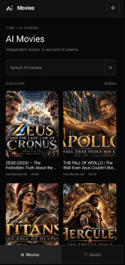
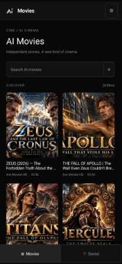

# AI Movies — Android downloads

Download the latest APK from [Releases](https://github.com/GianCarlozxc/AiMoviesRelease/releases/latest).

AI Movies browses full-length AI films from the selected channels and includes a custom native player, quality selection, fullscreen pinch zoom, dark/light themes, and an optional privacy-enhanced playback fallback.

Requires Android 8.0 or newer. Version 1.2 is a debug-signed test build using the same certificate as 1.0 and 1.1. Download `AiMovies-v1.2.apk` for the first installation. Existing installations using the same signing certificate can update in place.

Version 1.2 adds a floating rounded Movies/Saved navigation bar, with large Home and bookmark icons, a selected pill and dark/light colors. The screenshots below show the previous catalog/player layout; the updated APK includes the new navigation.

Version 1.1 checks for updates on Home and offers **Update** or **Update later**. You can still update through **Settings > Check for updates** after choosing Update later. Future updates download inside the app, verify the APK and open Android's installation confirmation. If requested, allow Movies to install apps in Android Settings. Install 1.1 once to enable this feature on a 1.0 installation.

  

Each release includes an APK, SHA-256 checksum, in-app update metadata (`update.json`), and third-party notices. Source code and Android Studio build instructions are in [AiMovies]

Playback depends on source availability and network limits; the privacy fallback does not guarantee unrestricted or ad-free playback.
